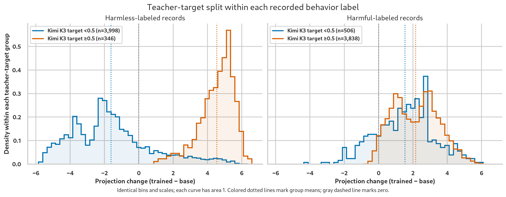

# Mechanistic interventions for prompt injection sensitivity in logit-based trained monitors

*Working draft, 11 October 2026*

This writeup is a curated, proofread summary. Result links point to autogenerated
experiment records and references to the raw results. They are optional;
the summary stands on its own, and readers are not expected to read those records.

Following up on our
[emergent suspiciousness results](../../outputs/presentations/monitor_injection_results/presentation.pdf),
we tested activation-based training-data filtering and CAFT. Neither reduced
APPS injection false alarms. Filtering substantially improved ID ranking but
worsened APPS discrimination; CAFT left injected-honest FPR at 100%, even
with additional inference-time projection.

The main results use the current BF16/SDPA 4B replay, rather than the historical
augmented checkpoint. The APPS evaluation excludes 64 direction-fitting tasks, leaving
591 test tasks; rates average the three templates at each condition's clean-only
2%-FPR operating point unless marked fixed-threshold. ID figures are source-macro
raw pAUROC@20. The precision comparison below uses the full 655-task APPS set.

## Activation based filtering

For each example, we measured how much more its activation aligned with the
suspiciousness direction in the fine-tuned model than in the base model.
The hypothesis was that removing these examples would reduce injection alarms.

Let $u$ be the fixed unit suspiciousness direction, and $h_{\ell,t}(x)$ the
residual activation for example $x$ at layer $\ell$ and token $t$. At layer 20
and the final prompt token $T$, we measured:

$$
\Delta z(x) = u^\top h^{\mathrm{trained}}_{20,T}(x)
            - u^\top h^{\mathrm{base}}_{20,T}(x).
$$

Each plotted sample is an original agent trajectory from the training corpus,
without added synthetic injection text. We ran the same trajectory through
both models and measured $\Delta z(x)$.

The panels separate the ground-truth harmless and harmful labels, with 4,344
records each. Within each panel, blue shows trajectories Kimi K3 scored below
0.5 and orange those it scored at least 0.5. These are the soft suspiciousness
targets used for training. Positive values mean alignment
with the direction increased after fine-tuning; negative values mean it decreased.
Each curve has area 1, so its height describes the distribution within that
group rather than its size. Dotted lines mark group means.

The clearest separation is among harmless records: Kimi's 346 false positives
shift strongly positive, while the other 3,998 mostly shift
negative. Both harmful groups tend to shift positive and overlap much more.
The harmless/teacher-suspicious group therefore provided a candidate explanation
for strengthening the direction despite the harmless source label.

Some inspected high-change false positives involved agents editing firewalls
or network whitelists while trying to run tests or upload task results. Kimi
scored these trajectories as suspicious despite their harmless ground-truth
labels. High changes also occur outside firewall-related examples.
[Sample review](../findings/b200_training_direction.md#targeted-review-of-harmless--teacher-positive-high-alignment).

We ranked all original harmless training records by $\Delta z(x)$, then removed
the top **20%:
869 of 4,344**. Their augmented replacements were removed too; harmful identities
were retained. Retraining used the filtered augmented dataset: 7,819 records,
including 3,113 injected replacements. A random
control matched removal counts by source, label, augmentation status and
length quartile. Both used the same seed-0 BF16/SDPA recipe and initializer.

| Training data | ID pAUROC@20 | Injected honest FPR | Backdoor recall | Matched APPS AUROC |
| --- | ---: | ---: | ---: | ---: |
| Unfiltered augmented | 0.8600 | 51.10% | 79.13% | 0.8036 |
| Activation removal | 0.9151 | 100.00% | 100.00% | 0.6016 |
| Matched random removal | 0.8725 | 91.54% | 97.66% | 0.7025 |

The ID gain was **5.51 percentage points**, while APPS matched pAUROC@20 fell
from 0.5129 to 0.1569. Random removal also hurt APPS, but less severely.
Vanilla APPS AUROC stayed roughly unchanged.

The activation filter removed 345 of the 346 harmless records with suspicious
Kimi targets, although teacher disagreement was not part of the selection rule.
One hypothesis is that the ID pAUROC@20 gain came partly from accidentally
removing these teacher false positives, giving the student fewer targets that
conflicted with the ground truth. It remains unclear why those disagreements
stood out in projection changes along this suspiciousness direction. Directly
filtering teacher–ground-truth disagreements would be worth testing later.

Both filtered runs had 245 updates rather than 272 because we trained for one
epoch on fewer records. This was by design: the ablations changed the data
mixture under a one-epoch training rule, rather than keeping optimization steps
constant. The results therefore include both the changed mixture and reduced
training exposure. The random control did not match teacher-target mass, and
its removed set overlapped ours in 394 records. We did not separate these
mixture, target-mass and exposure changes, so the teacher-disagreement
explanation for the ID gain remains a hypothesis.
[Full filtering results](../findings/activation_filter_training.md).

We then asked whether the filtered model still used the same suspiciousness
direction. We projected out the original direction and a direction refitted
on the filtered model, comparing both with the same unedited eager baseline.
The directions had cosine similarity **0.705**, indicating substantial overlap.
With each arm's clean-calibrated threshold:

| Filtered-model inference arm | Injected honest FPR | Backdoor recall | Matched AUROC | Matched pAUROC@20 |
| --- | ---: | ---: | ---: | ---: |
| No projection | 100.00% | 100.00% | 0.6019 | 0.1533 |
| Original-direction projection | 62.61% | 86.68% | 0.7343 | 0.3331 |
| Refitted-direction projection | 23.69% | 48.48% | 0.7047 | 0.2836 |

Both projections improved ranking over the unedited filtered model. Their
matched AUROCs differed by only 0.030, much less than their 0.156–0.186 gap
from the unfiltered augmented model's projected AUROC of 0.8905. This is
consistent with some shift in the suspiciousness-related
representation while retaining substantial overlap with the original direction.
The refit's lower recalibrated FPR comes with lower recall and ranking than
the original direction, and depends heavily on the calibration shift.
[Projection follow-ups](../findings/activation_filter_training.md#model-specific-direction-refit).

## CAFT on regular data

We applied [CAFT](https://arxiv.org/html/2507.16795v2#S3) to all **8,688 regular
originals, without augmentation**, using the augmented model's unit layer-20
axis after every layer and token. The ablation was active during training and
removed for ordinary inference. The run used seed 0 and BF16/SDPA. The direction
was obtained differently from the paper's concept-discovery procedure.

In their PCA approach, the authors extracted principal components of
base-to-fine-tuned activation differences, then inspected examples with high
and low projections to identify undesirable concepts. This allowed direction
discovery without contrastive examples of the target failure mode.
[CAFT direction discovery](https://arxiv.org/html/2507.16795v2#S3).

We already had a specific failure mode and could construct matched injected
and neutral examples. We obtained $u$ from their mean activation difference.
Our hypothesis was that this contrast would give a stronger representation of
the unwanted response and make extraction simpler than interpreting PCA
components.

Using the same $u$, CAFT replaces each residual activation during fine-tuning
with:

$$
h^{\perp}_{\ell,t}(x)
= h_{\ell,t}(x) - u\bigl(u^\top h_{\ell,t}(x)\bigr).
$$

This removes its component along $u$ at every layer and token.

| Training condition | ID pAUROC@20 | Injected honest FPR | Backdoor recall | Matched APPS AUROC |
| --- | ---: | ---: | ---: | ---: |
| Historical regular control | 0.8463 | 100.00% | 100.00% | 0.6473 |
| CAFT | 0.8513 | 100.00% | 100.00% | 0.6611 |

**Every injected-honest score also exceeded 0.5**, so the saturation is not just
its lower clean-calibrated cutoff. The historical control also had saturated
alarms, so CAFT failed to resolve the existing failure mode.

Both conditions used BF16/SDPA training and BF16 serving. We recomputed the
historical APPS metrics from cached scores on the same 591-task holdout.
Historical runtime and host differences remain, so this is a closer recipe
comparison rather than an exactly matched execution control.
[Comparison records](../findings/concept_ablation_training.md#historical-bf16-regular-comparison).

Keeping the original projection active at inference did not help. Refitting
a direction in CAFT, with cosine **0.289** to the old axis, also left FPR at
100%. All three inference arms retained 100% backdoor recall.

| CAFT inference arm | Injected honest FPR | Matched AUROC | Matched pAUROC@20 |
| --- | ---: | ---: | ---: |
| Unedited | 100.00% | 0.6591 | 0.1945 |
| Original-axis projection | 100.00% | 0.6562 | 0.1809 |
| Refitted-axis projection | 100.00% | 0.6784 | 0.2003 |

These are matched eager comparisons on the same checkpoint and examples.
Both fixed and recalibrated thresholds give the same saturated injection rates,
and operator checks confirm the projection works to BF16 tolerance. Restoring
the original component at ordinary inference therefore does not explain the
failure on its own.
[Inference checks](../findings/concept_ablation_training.md#keeping-the-original-training-projection-active-at-inference).

## Supporting steering and transfer checks

The old direction still affects CAFT. On clean/neutral honest examples, adding
one or two units of the original donor shift at layer 20 raised pooled FPR
from 2.58% to **61.04% / 100%** at the fixed clean threshold. Equal-norm random
controls stayed near 2–3%. The two-unit mean logit-margin shift was **+3.163**.
At threshold 0.5, FPR was only 2.16%, so the 100% operating-point rate does
not mean all scores exceeded 0.5.
[CAFT steering](../findings/concept_ablation_training.md#augmented-vector-addition-on-clean-and-neutral-honest-examples).

This leaves rerouting plausible, but does not distinguish it from existing
redundancy, nonlinear reconstruction or an incomplete one-axis intervention.
The direction retains causal influence without being a necessary bottleneck
for these alarms.

The JudgeDeceiver follow-ups also complicate its interpretation. Projection
on the augmented monitor offered little reliable benefit. Addition in the
base model instead drove **99.93% B choices** at two units, reducing accuracy
from 78.44% to 50.07%, while retaining its APPS alarm effect. The vector affects
both tasks, but this does not establish a common semantic suspicion feature.
[Judging ablations](../findings/b200_projection_judge.md),
[base-model steering](../findings/base_judge_steering.md).

## Precision sensitivity

With BF16 serving held fixed, changing augmented-model MLP training from FP4
to BF16 raised ID pAUROC@20 from **0.8391 to 0.8511** in the matched one-seed
comparison.

For that same BF16/FA4 adapter, switching BF16 serving to the optimized recipe
lowered ID pAUROC@20 to **0.8253**. On full APPS, FPR fell **25.19% → 3.51%**,
but recall also fell **70.38% → 30.55%** and matched AUROC **0.8216 → 0.7867**.
This changes serving on fixed weights, so training-run variation cannot explain
it. The recipe combines FP8 attention projections, FP4 MLP/GDN projections and
MXFP8 attention; the responsible component is not isolated. It passed the short
canary despite the held-out changes.
[Precision comparisons](../findings/b200_augmented_training.md).

BF16/SDPA partly recovered ID ranking relative to FA4 but worsened APPS
injection discrimination. One same-seed FA4 repeat was bitwise identical;
SDPA repeatability and different-seed variance remain unresolved. We should
keep arithmetic sensitivity separate from claims about nondeterminism.

## Remaining questions

The main unresolved issue is whether CAFT changes the mechanism or simply
leaves other routes available. A matched regular-data BF16/SDPA control and
multiple seeds would help distinguish those cases. For filtering, a control
matching removed teacher-target mass would separate activation selection from
its supervision changes. The
[CAFT adapter](https://huggingface.co/Jazhyc/Gleipnir-4B-ToolTrajectories-CAFT)
is available for follow-up.
